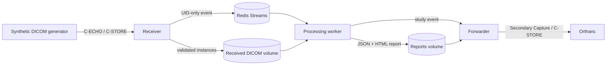

# dicom-flow

A small, service-oriented DICOM pipeline portfolio demo:



**Demo only, not a medical device. Use only synthetic DICOM generated by this
project; do not send real patient data.** The inference implementation is
deterministic mock code and must not be used for clinical decisions.

## Quick start

Requirements: Python 3.12, `uv`, Docker, and Docker Compose.

1. Copy `.env.example` to `.env` and replace `ORTHANC_PASSWORD` with a local
   password. The Orthanc HTTP API is internal to the Compose network and
   password-protected.
2. Start the services:

   ```bash
   docker compose up --build
   ```
3. In another terminal, generate and send a synthetic study:

   ```bash
   uv sync
   uv run dicom-flow generate --output ./data/synthetic --instances 2 --seed 7
   uv run dicom-flow send ./data/synthetic
   ```

The receiver stores DICOM under `StudyInstanceUID/SeriesInstanceUID/InstanceUID`.
The worker writes `result.json` and `report.html` under the study folder in the
Compose `report-data` volume. The forwarder sends a synthetic DICOM Secondary
Capture result to Orthanc. Orthanc's DICOM and HTTP ports are not published to
the host by default.

## Services and configuration

- **Receiver:** ultrasound C-STORE SCP with C-ECHO support, validation, durable
  disk storage, calling AE-title allow-list, and UID-only Redis event
  publication.
- **Redis:** Streams broker. Set stream/group names and bounded retry limits
  with the `DICOM_FLOW_*` variables in `.env`.
- **Worker:** consumer-group processing, deterministic mock detection and
  classification using [the versioned YAML configuration](src/dicom_flow/inference/mock_inference.yaml),
  config SHA-256 recorded in the result, JSON and HTML report generation, and
  report-to-forward event publication.
- **Forwarder:** constructs a synthetic-identity demo Secondary Capture containing
  synthetic patient attributes, model/config provenance, and a non-clinical
  disclaimer. It checks the destination host and AE title against allow-lists
  before C-STORE.
- **Orthanc:** private-network demonstration destination. Provide
  `ORTHANC_PASSWORD` via environment or the uncommitted `.env` file.

Outbound TLS is optional. Set `DICOM_FLOW_TLS_ENABLED=true`; by default the
client verifies certificates against system trust roots, or can use
`DICOM_FLOW_TLS_CA_FILE`. Client certificate and key paths are supported for
mutual TLS. With Compose, mount local files under the ignored `certs/` folder
and use container paths such as `/run/dicom-flow-tls/ca.pem`. The destination
must itself be configured for DICOM TLS; the included Orthanc demo endpoint
uses plain DICOM on the private Compose network.

Compose health checks cover receiver TCP readiness, Redis connectivity for
worker/forwarder, and Orthanc HTTP readiness. Manual checks use these commands inside the appropriate network/container
context:

```bash
uv run dicom-flow health receiver
uv run dicom-flow health worker
uv run dicom-flow health forwarder
uv run dicom-flow health orthanc
```

## Tests and quality checks

Copy the example environment and set `ORTHANC_PASSWORD` to a local password
before starting Redis and running the checks:

```bash
cp .env.example .env
docker compose up --detach redis
uv sync
uv run pytest
uv run ruff check .
uv run mypy
docker compose build
```

Pytest enforces the configured 70% coverage floor. Integration tests exercise
real Redis and a local pynetdicom SCP; the e2e test generates synthetic DICOM,
sends it to the receiver, processes it, and checks its reports. The golden
inference fixture guards deterministic output. CI runs these checks and a
Docker build.

## Limitations

- A processing event is emitted per stored instance; studies can be processed
  and forwarded more than once as instances arrive. Reports are replaced at a
  stable per-study path, but the destination may observe duplicate sends.
- This demo does not implement study-completion timeouts, exactly-once
  processing, Redis pending-message claiming, or production secrets
  provisioning.
- The mock inference is not a real AI model. The forwarded Secondary Capture
  contains a synthetic pixel pattern, not a clinical visualization.
- AE-title allow-lists are not cryptographic identity. Use network isolation
  and properly managed TLS certificates for any non-demo deployment.

See [architecture](docs/architecture.md),
[next-step handoff](docs/next-steps.md),
[requirements traceability](docs/requirements-traceability.md),
[risk analysis](docs/risk-analysis.md),
[SOUP list](docs/soup-list.md), and the
[verification report template](docs/verification-report-template.md).
