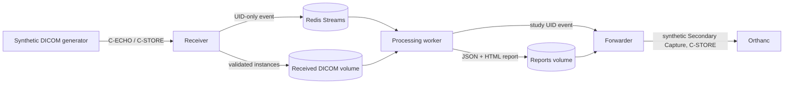

# Architecture

This is a demo pipeline, not a medical device. All repository tests and
examples use DICOM instances generated by the project.

## Trust boundaries and data flow

- The receiver accepts ultrasound image storage only and enforces a configured
  calling AE-title allow-list. It writes files before publishing events and
  returns a failure status when event publication fails.
- Redis carries study, series, and instance UIDs plus attempt metadata. It
  does not carry pixel data or patient attributes.
- The worker reads validated files from the shared received volume, applies the
  versioned mock configuration, and writes one result and HTML report per
  study.
- The forwarder reads result JSON and constructs a synthetic Secondary
  Capture. The output uses a synthetic patient name and ID, includes provenance
  and a demo disclaimer, and is sent only to a configured allow-listed host
  and AE title.
- Optional outbound TLS verifies the destination using the system trust store
  or a configured CA file. A client certificate/key can be configured for
  mutual TLS. The receiving DICOM node must independently support/configure
  TLS; the included Orthanc demo endpoint uses plain DICOM on the private
  Compose network.
- Compose keeps Orthanc's DICOM and HTTP ports unpublished. The Orthanc HTTP
  API requires a password provided through `ORTHANC_PASSWORD` in the
  environment or an uncommitted `.env` file.

## Operational behavior and limitations

Processing is triggered per received instance, not after a study-completion
timeout. A study may therefore be processed more than once as instances arrive.
Reports are idempotently replaced at their study path; the forwarder may send
the current result more than once. Redis consumer groups acknowledge success
and re-enqueue failure with a bounded attempt counter. This demo does not
implement pending-entry claiming or exactly-once delivery.
